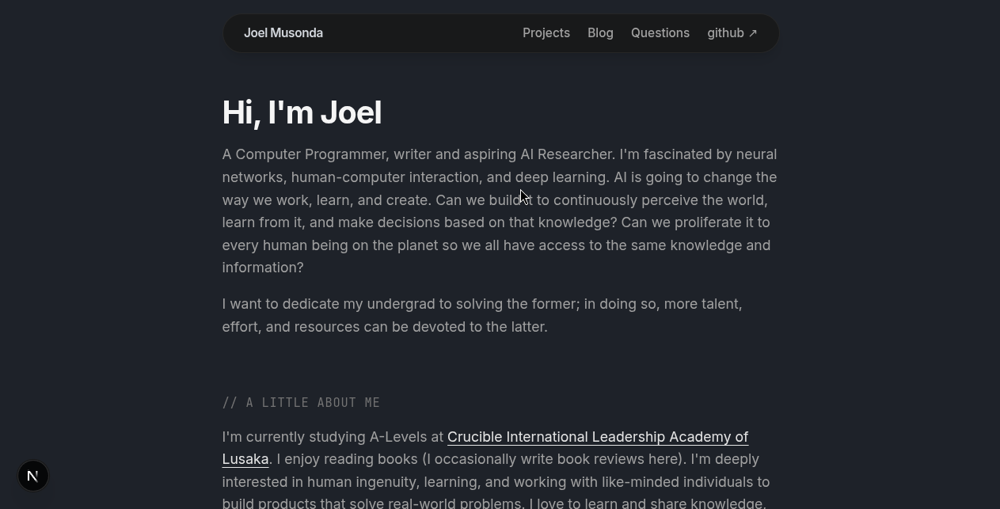
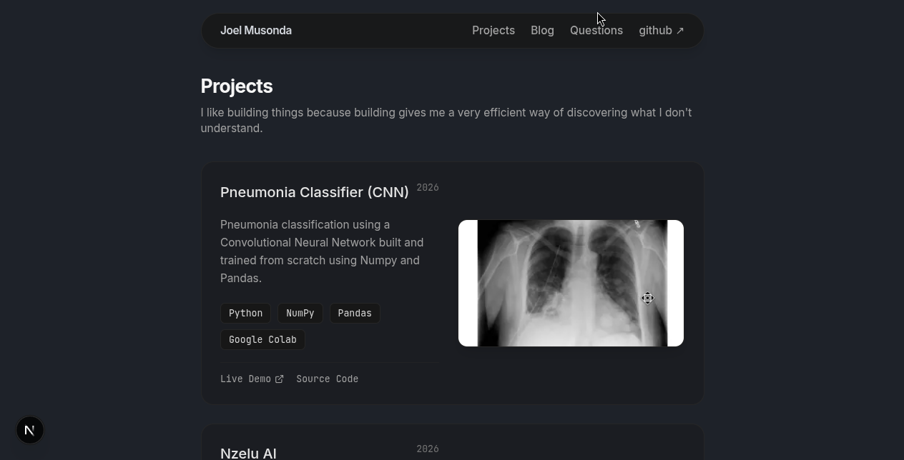

# Personal Portfolio & Blog

A minimalist, high-performance personal portfolio and blogging platform built with modern web technologies. Designed with a dark-themed slate aesthetic, high-contrast typography, and seamless content management.

---

## 📸 Screenshots


| Home Page | Projects View |
| :---: | :---: |
|  |  |

---

## 🗂️ File Structure

Here is an overview of the project's directory structure and core architectural layout:

```text
portfolio/
├── .velite/              # Generated JSON output and cache from Velite (git-ignored)
├── content/
│   └── blog/             # Markdown (.mdx) blog posts with frontmatter schemas
│       ├── your blog title.mdx
│       └── another blog title.mdx
├── public/               # Static assets, favicons, and images
│   └── favicon.ico
├── src/
│   ├── app/              # Next.js App Router pages and layouts
│   │   ├── blog/
│   │   │   ├── [slug]/page.tsx   # Dynamic individual blog post view
│   │   │   └── page.tsx          # Blog index listing page
│   │   ├── projects/
│   │   │   └── page.tsx          # Projects showcase page
│   │   ├── questions/
│   │   │   └── page.tsx          # Questions/thoughts page
│   │   ├── globals.css           # Global custom slate theme variables & styles
│   │   ├── layout.tsx            # Root layout wrapper with navigation & footer
│   │   └── page.tsx              # Home page
│   ├── components/       # Reusable UI components
│   └── lib/              # Utility functions and shared logic
├── velite.config.ts      # Velite content layer configuration & schemas
├── tailwind.config.ts    # Tailwind CSS styling extensions & typography plugin
├── package.json          # Project dependencies and build scripts
└── tsconfig.json         # TypeScript configuration
```

---

## 🛠️ Tech Stack & Architecture Choices

Every technology in this stack was chosen to maximize performance, developer experience, type safety, and maintainability:

* **[Next.js 16 (App Router & Turbopack)](https://nextjs.org/)**
  * *Why chosen:* Chosen for its powerful server-side rendering, file-based routing, and exceptional SEO capabilities. Next.js App Router allows server-side data fetching for markdown content with minimal client-side JavaScript overhead. Turbopack provides lightning-fast local compilation.
* **[TypeScript](https://www.typescriptlang.org/)**
  * *Why chosen:* Enforces strict static typing across components, props, and content layers, reducing runtime errors and improving long-term code maintainability as the project expands.
* **[Tailwind CSS](https://tailwindcss.com/)**
  * *Why chosen:* Enables rapid UI iteration using utility classes combined with custom CSS variables to match a cohesive dark slate palette (`#1e2229` background with `#d1d5db` readable text).
* **[Velite](https://velite.js.org/)**
  * *Why chosen:* Acts as a lightning-fast, type-safe content layer. Velite validates Markdown/MDX frontmatter (titles, dates, summaries) at build time and turns them directly into strongly-typed JSON objects, avoiding heavy runtime databases or complex CMS setups.
* **[Vercel](https://vercel.com/)**
  * *Why chosen:* Provides seamless CI/CD integration with zero-config deployments, automatic preview branches, and edge-optimized asset delivery.

---

## 🔄 Development Methodology & Workflow

This project was built using an **iterative and agile development approach**, focusing on incremental feature delivery and continuous improvement:

1. **Modular Component-Driven Design:** The user interface was structured into atomic, reusable sections (floating glassmorphic navigation headers, responsive content wrappers, and dynamic grid layouts) to ensure design consistency across mobile and desktop viewports.
2. **Content-First Architecture:** Leveraging Markdown and Velite allowed content creation to be decoupled from application logic. Blog posts are written independently in `.mdx`, verified against strict frontmatter schemas, and compiled automatically.
3. **Continuous Deployment Pipeline:** Local development utilizes file watchers (`velite --watch`) to instantly sync content changes, while production builds rely on a custom Vercel compilation script (`npx velite && next build`) to guarantee type-safe content delivery on every push.

---

## 🚀 Getting Started Locally

### 1. Clone the repository
```bash
git clone https://github.com/joel-musonda/portfolio.git
cd portfolio
```

### 2. Install dependencies
```bash
npm install
```

### 3. Run development mode
*Note: This starts Velite in watch mode alongside the Next.js development server so your MDX content compiles dynamically.*
```bash
npm run dev
```

Open [http://localhost:3000](http://localhost:3000) in your browser.

---

## 📝 Adding New Content

Create a new `.mdx` file inside the `content/blog/` directory with the required frontmatter schema:

```mdx
---
title: "Your Post Title"
date: "YYYY-MM-DD"
summary: "A brief summary of what this post covers."
---

Write your markdown or code blocks here...
```

---

## 📄 License

Feel free to explore the repository structure and code, but please do not directly plagiarize personal content or brand assets.

Happy Hacking!!